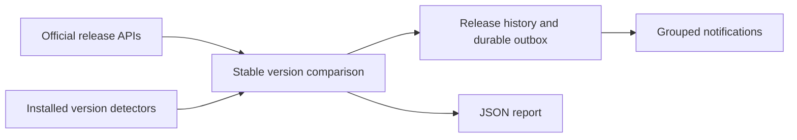

# Pharos

[](https://github.com/zvckster/pharos/actions/workflows/ci.yml)

**Know what's released.**

Pharos watches official software releases and tells you when a new stable version appears. It compares those releases with the software you run, groups notifications, and remembers what it has already announced.

A container image can change several times without a new application release. Pharos follows upstream release versions, so those rebuilds stay quiet. It works with containers and native packages.

**Status: early alpha, version 0.1.1.** The core policy grew from a working personal-server monitor. This standalone implementation is new and needs broader testing. It does not upgrade software. No hosted service or account is required.

## Quick start

Requires Python 3.11+ on Linux. The container uses Python 3.15; CI also checks the Python 3.16 development branch. There are no runtime Python dependencies.

```sh
git clone https://github.com/zvckster/pharos.git
cd pharos
python3 -m venv .venv
.venv/bin/pip install .
cp examples/pharos.json pharos.json
# Edit pharos.json: choose your applications and remove unwanted examples/channels.
.venv/bin/pharos validate
.venv/bin/pharos check --dry-run
.venv/bin/pharos check
```

The first real check quietly records the current upstream versions. Existing version gaps appear in the report without a burst of old notifications. A dry run writes `preview.json`, leaves notification state unchanged, and sends nothing—even with `--notify`.

```sh
.venv/bin/pharos check --notify  # Check once and deliver pending alerts.
.venv/bin/pharos watch --notify  # Repeat every six hours by default.
.venv/bin/pharos report         # Print the latest JSON report.
```

Use `--config /path/pharos.json` and `--state-dir /path/state` after the subcommand, or set `PHAROS_CONFIG` and `PHAROS_STATE_DIR`. The default state directory is `~/.local/state/pharos`. `--force-refresh` bypasses the one-hour upstream cache.

## A small configuration

```json
{
  "schema_version": 1,
  "interval_seconds": 21600,
  "checks": [
    {
      "id": "caddy",
      "name": "Caddy",
      "source": {"type": "github", "repo": "caddyserver/caddy", "major": 2},
      "installed": {"type": "dpkg", "package": "caddy"}
    }
  ],
  "notifications": [
    {
      "id": "phone",
      "type": "ntfy",
      "url": "https://ntfy.example.org",
      "topic": "releases",
      "token_env": "PHAROS_NTFY_TOKEN"
    }
  ]
}
```

Keep credentials in environment variables, outside the JSON catalogue and version control. Missing configured secrets fail delivery and retain the event for a later retry. An empty notification list is valid for reporting alone.

## How it works



Source fetches and installed-version detection are separate from notification delivery. The history ledger suppresses repeated versions, while the outbox survives restarts and tracks each delivery channel independently.

## Release sources

| `source.type` | Configuration | Behavior |
|---|---|---|
| `github` | `repo: owner/project`, optional `token_env` | Reads up to 100 releases from GitHub's official API |
| `forgejo` | `url` pointing to the repository releases API | Supports Codeberg and self-hosted Forgejo |
| `gitlab` | `url` pointing to `/api/v4/projects/PROJECT/releases` | Supports GitLab release arrays |
| `json` | `url`, optional `version_field` (default `tag_name`) | Object or array containing stable numeric version strings |
| `manual` | Optional check-level `note` | Explicitly reports that no reliable feed is configured |

All source URLs require HTTPS. Optional `major` pins a major release line. Pharos chooses the highest stable numeric version returned, regardless of API ordering; draft, prerelease, upcoming and recognizable development versions are excluded. It supports dotted numeric versions, including calendar versions. Packaging suffixes such as `-ls25` are normalized away. Arbitrary nonnumeric release tags are unsupported and reported as incomplete checks.

Generic JSON entries may provide `html_url` or `url`, plus `published_at`. GitLab's `_links.self` and `released_at` are also recognized. Feed URLs should return enough entries to include your supported release line: there is currently no pagination. Pharos checks APIs, not GitHub release notification emails. A release published without a version change does not trigger another alert.

GitHub's anonymous API limit is low. Use an environment-backed read token for large catalogues or other workloads sharing an IP. ETags, one-hour caching and six concurrent workers reduce requests. Network operations have socket timeouts, response-size limits and restricted redirects. They do not provide a strict whole-run wall-clock deadline; the supplied systemd unit supplies one.

## Installed-version detection

| `installed.type` | Configuration |
|---|---|
| `docker` | `container`, optional `label` or `use_tag: true` |
| `dpkg` | `package` on the host running Pharos |
| `rpm` | `package` on the host running Pharos |
| `command` | `argv` array, optional regex `pattern` with a capture group |
| `static` | `version`, updated by you |
| `unknown` | Announces new releases without claiming to know the installed version |

Docker detection defaults to `org.opencontainers.image.version`. With `use_tag`, use explicit version tags; floating tags remain unknown. Image labels can be inaccurate: select a reliable custom label, use an explicit command, or mark the installed version unknown. Pharos does not infer application versions from commit hashes or image digests.

Commands run without a shell, with a 20-second timeout and a 1 MiB combined stdout/stderr limit, as the Pharos user. Pharos terminates the process group on timeout or excess output. Empty stdout falls back to stderr for programs that print versions there. Ambiguous output containing multiple dotted versions requires a capture pattern. For an app inside a container:

```json
{"type": "command", "argv": ["docker", "exec", "app", "app", "--version"], "pattern": "app v([0-9.]+)"}
```

Configuration is trusted executable input because detectors can run commands. A container installation cannot inspect host packages or run the host's Docker CLI by default. Use the native installation for those checks. The Docker example supports release tracking, static versions and commands available inside its own container.

## Built-in notifications

| Type | Fields |
|---|---|
| `ntfy` | `url` (server root), `topic`, optional `token_env` |
| `email` | `host`, `from`, `to` array; optional `port`, `security`, `username`, `password_env` |
| `gotify` | `url` (server root), `token_env`, optional `priority` |
| `webhook` | `url`, optional `token_env` (Bearer authentication) |

Every channel has a unique, stable `id`. SMTP uses STARTTLS by default or implicit TLS with `security: tls`; certificate verification is enabled. HTTP is permitted for notification endpoints on private networks; use HTTPS across untrusted networks. Notification redirects are rejected to protect credentials. ntfy uses JSON publishing, supporting Unicode titles. Long ntfy messages are truncated with a notice to consult the report.

Webhook POST bodies include `schema_version`, event `id`, `title`, `changes`, and human-readable `message`. Requests carry `Idempotency-Key`. Give consumers durable deduplication keyed on the event ID.

```json
{"id": "chat", "type": "webhook", "url": "https://hooks.example.org/releases", "token_env": "PHAROS_WEBHOOK_TOKEN"}
```

Pending events are persisted before delivery. Each successful channel is acknowledged separately; later checks retry only failed channels. **Delivery is at least once:** a crash after a remote service accepts a message but before local acknowledgement can cause a duplicate. SMTP partial recipient acceptance can also cause duplicates on retry. Exactly-once network delivery is not promised. Each event snapshots its target channel IDs. Removing a target preserves its undelivered notification and reports a delivery error until that channel is restored. New channels do not receive old events that already have targets. Events queued with no channels bind to the configured destinations on their first delivery attempt. Keep channel IDs stable; changing an endpoint under an existing ID affects its outstanding deliveries.

## Alert policy and state

- First observation of each source establishes a quiet baseline.
- Each new, higher stable version produces one release event, grouped with other changes from the check.
- Already installed versions, prereleases, same-version rebuilds, rollbacks and previously seen versions are silent. A version below the highest previously observed release cannot become a new-release alert after a rollback.
- Changing a source definition establishes a new baseline for that check.
- `notify: false` keeps an app report-only.
- Unknown installed versions are labeled unknown, never current.
- Failures appear in reports and produce a nonzero check exit code. Three consecutive incomplete runs queue one diagnostic notification per incident.
- There are no automatic updates, pulls, restarts or release-download executions.

`state.json` stores source cache, observed release history and pending notification acknowledgements. Preserve it across upgrades and container recreation. Losing it creates a fresh quiet baseline. Corrupt or unknown state schemas, invalid nested observations, malformed caches and damaged pending events cause a controlled error rather than resetting state. Atomic writes, disk synchronization and a process lock protect against partial files and overlapping checks. Use a local Linux filesystem; distributed locks and Windows are unsupported.

`latest.json` distinguishes `current`, `behind`, `ahead`, `unknown`, `manual` and `error`. It includes release links, new changes and pending delivery count. Reports and state use private file permissions. No notification credentials are written to either.

## Deployment

### Native systemd

Create a dedicated `pharos` user, install a virtualenv at `/opt/pharos/venv`, put the catalogue at `/etc/pharos/pharos.json`, and create a root-owned mode-0600 `/etc/pharos/notifications.env` containing only the required environment variables. Install the files from `deploy/` under `/etc/systemd/system/`:

```sh
sudo systemctl daemon-reload
sudo systemctl enable --now pharos.timer
systemctl list-timers pharos.timer
journalctl -u pharos.service
```

The timer checks every six hours with jitter and catches missed runs. Use either the timer or `pharos watch`, not both. The supplied unit assumes Linux/systemd and restricts filesystem writes to its state directory. Add Docker group membership only if container detection is required; Docker daemon access grants extensive host privileges. Pharos itself does not require root for API tracking.

### Docker Compose

```sh
cp examples/pharos.json pharos.json
# Edit checks for the capabilities available inside this container.
# Export only the notification secret variables your catalogue references.
docker compose build
docker compose run --rm pharos validate
docker compose up -d
```

The container runs as UID 10001 with persisted state, a read-only root filesystem and no Docker socket mount. The default image deliberately contains no Docker CLI. Host inventory support is available through the native installation. Health should be assessed from `latest.json` timestamps and check errors; there is no HTTP health server yet.

## Development

```sh
python3 -m venv .venv
.venv/bin/pip install -e ".[dev]"
.venv/bin/ruff check src tests
.venv/bin/ruff format --check src tests
.venv/bin/python -m unittest discover -s tests -v
```

Tests use synthetic feeds, mocked SMTP and a local HTTP receiver; they never notify real recipients. CI tests Python 3.11–3.15, checks Python 3.16 development builds in an experimental job, builds a wheel, checks the example catalogue and builds the container. Weekly CI tracks future runtime changes. See [the runtime decision](docs/architecture.md) for the Python/Go assessment. See [CONTRIBUTING.md](CONTRIBUTING.md) for provider contributions and [SECURITY.md](SECURITY.md) for the trust model.

## Upgrading from 0.1.0

Preserve `state.json` and upgrade the package or rebuild the container. Version parsing changed in 0.1.1, so source caches and upstream observations establish a fresh quiet baseline once; pending notification deliveries are preserved and legacy events bind targets on first delivery. This prevents versions misclassified by the old parser from poisoning future comparisons. Do not delete the state file to upgrade.

## Scope and roadmap

This first version is a release monitor, not a vulnerability scanner. A rebuild may fix an operating-system vulnerability without changing the app version; release-only monitoring intentionally does not alert on that. Keep security patching and vulnerability scanning alongside it.

Planned work: additional official vendor feeds, import of the original personal-server catalogue, richer version schemes and release channels, catalogue templates, Docker/Compose discovery, a web report, more notification adapters and published signed artifacts. These are not implemented features.

Pharos began after repeated rebuild alerts made it hard to spot application releases. DIUN remains useful for registry changes; projects with predictable version tags can also tune its repository/tag filters. Pharos serves the upstream-release workflow across container and native software.

The name Pharos is also used by unrelated projects. This project is distributed as `pharos-release`; it has no affiliation with those projects, and registry/name availability has not been reserved.

MIT licensed. Contributions welcome.
